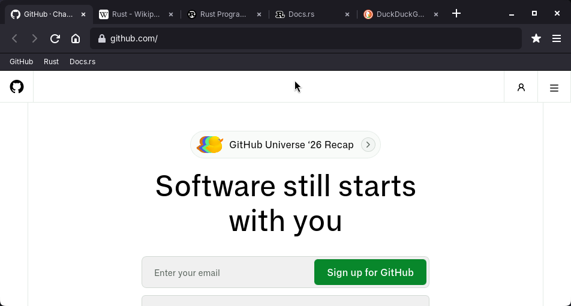
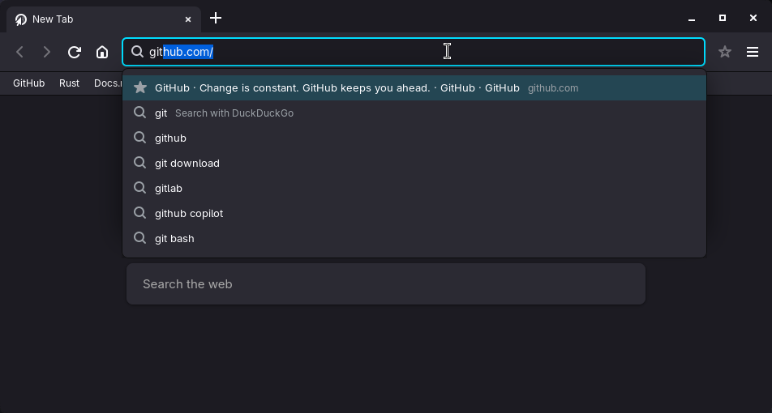
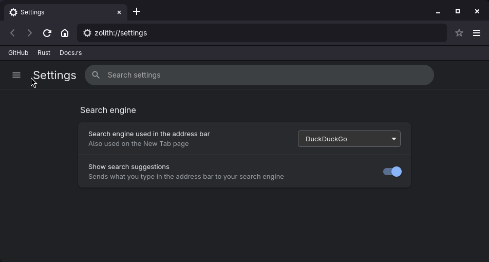

<div align="center">


# Zolith

**A fast, minimal web browser for Linux, written in Rust.**

Chrome-style tabs and settings, a smart address bar, and a built-in ad blocker.
No Electron, no Chromium: just GTK and your system's WebKit.

[Download](https://github.com/ash262049-png/zolith/releases/latest) ·
[Features](#features) ·
[Build from source](#build-from-source) ·
[Shortcuts](#keyboard-shortcuts)



</div>

## Features

**Tabs**
- Chrome-style tab strip: tabs share the width evenly, shrink as you open more, and scroll when they run out of room
- Site icons, a loading spinner, middle-click to close, reopen closed tabs, `Ctrl+1`–`9` to jump
- Pinned tabs, drag to reorder, and a right-click tab menu (duplicate, close others, close to the right)
- Session restore: pick up where you left off

**Address bar**
- Type the start of a site you visit and it completes inline: `you` becomes `youtube.com/`, and Enter goes straight there
- A dropdown of matching bookmarks, history and live search suggestions (DuckDuckGo, Google, Bing, Brave)
- Search or address, decided as you type; `localhost` and local IPs open over `http`



**Ad blocking**
- Blocks about 110 well-known ad and tracking domains, hides common ad boxes, and skips YouTube video ads
- Optional community lists (EasyList and EasyPrivacy), downloaded on request from Settings
- Add your own domains in `~/.config/zolith/blocklist.txt`
- One switch in Settings turns it off

**Settings page** (`zolith://settings`, or `Ctrl+,`)
- Laid out like Chrome's: sidebar, search box, toggles
- Search engine (including your own URL), startup behaviour, home page, bookmarks bar, default zoom
- Clear browsing data: history, cookies and cache, over a time range
- Download folder



**Everything else**
- A new tab page with your most-visited sites
- Right-click menus for links, images, selected text and pages
- A downloads panel with progress, cancel, open and show-in-folder
- A history page (`Ctrl+H`) and Back/Forward history menus (right-click the buttons)
- Private windows (`Ctrl+Shift+N`): nothing is saved, and the window is marked purple
- Opens links from other apps in a tab of the running window; a "make default browser" button in Settings
- Import and export bookmarks as HTML, the format Chrome and Firefox use
- Bookmarks and a bookmarks bar, find in page, zoom, print, developer tools
- Downloads that never overwrite existing files, with a status message
- Middle-click or `Ctrl`+click opens a link in a background tab
- Fullscreen video hides the toolbar
- Sites ask before using your camera, microphone, screen or location, with a Chrome-style prompt under the address bar; answers are remembered per site and can be reset in Settings
- Spell check in text fields
- Dark theme, with colour themes to choose from (including an Opera-style red)
- A first-run setup guide: search engine, theme, bookmark import, default browser

## Install

### From a release

Download `zolith-0.1.0-linux-x86_64.tar.gz` from the [latest release](https://github.com/ash262049-png/zolith/releases/latest), then:

```bash
tar xzf zolith-0.1.0-linux-x86_64.tar.gz
cd zolith-0.1.0-linux-x86_64
./install.sh
```

This installs Zolith for your user only (no root): the program in `~/.local/bin`, plus its icon and an app-launcher entry.

You need these runtime libraries, which most desktops already have:

| Distro | Packages |
| --- | --- |
| Fedora | `webkit2gtk4.1 gtk3 libsoup3` |
| Debian / Ubuntu | `libwebkit2gtk-4.1-0 libgtk-3-0 libsoup-3.0-0` |
| Arch | `webkit2gtk-4.1 gtk3 libsoup3` |

### Build from source

You need [Rust](https://rustup.rs) and the development packages:

| Distro | Packages |
| --- | --- |
| Fedora | `webkit2gtk4.1-devel gtk3-devel libsoup3-devel` |
| Debian / Ubuntu | `libwebkit2gtk-4.1-dev libgtk-3-dev libsoup-3.0-dev` |
| Arch | `webkit2gtk-4.1 gtk3 libsoup3` |

```bash
git clone https://github.com/ash262049-png/zolith.git
cd zolith
cargo build --release
./install.sh
```

Or just run it without installing: `cargo run --release`.

> Developed and tested on Fedora with Wayland. Other distros and X11 should work but haven't been tried.

## Keyboard shortcuts

| | |
| --- | --- |
| `Ctrl+T` / `Ctrl+W` | New tab / close tab |
| `Ctrl+Shift+T` | Reopen closed tab |
| `Ctrl+Tab`, `Ctrl+Shift+Tab` | Next / previous tab |
| `Ctrl+1`–`8`, `Ctrl+9` | Jump to tab / last tab |
| `Ctrl+L`, `F6` | Focus the address bar |
| `Alt+←` / `Alt+→` | Back / forward |
| `Ctrl+R`, `F5` | Reload (stop while loading) |
| `Alt+Home` | Home |
| `Ctrl+F`, `Ctrl+G` / `F3` | Find, next / previous (`Shift`) match |
| `Ctrl+D` | Bookmark this page |
| `Ctrl+H` | History |
| `Ctrl+Shift+N` | New private window |
| `Ctrl+Shift+B` | Show / hide the bookmarks bar |
| `Ctrl++`, `Ctrl+-`, `Ctrl+0` | Zoom in / out / reset |
| `Ctrl+P` | Print |
| `F12`, `Ctrl+Shift+I` | Developer tools |
| `Ctrl+,` | Settings |
| `Ctrl+Q` | Quit |

## Your data

Everything stays on your machine:

| | |
| --- | --- |
| `~/.config/zolith/settings` | Your settings |
| `~/.config/zolith/bookmarks.tsv` | Bookmarks |
| `~/.config/zolith/history.tsv` | History (up to 3,000 pages) |
| `~/.config/zolith/blocklist.txt` | Your extra blocked domains, one per line |
| `~/.local/share/zolith/` | Cookies, cache and site data |

Search suggestions send what you type in the address bar to your search engine. Turn them off in Settings, under Search engine.

## Limitations

Zolith is young. Honest list of what it doesn't do yet:

- **Twitch stream ads are not blocked.** Twitch merges them into the video itself. Only its trackers are caught.
- **YouTube ad skipping is best-effort.** YouTube changes its page often, so it may need updating.
- The community filter lists turn off element hiding for sites that need extra rules, and skip anything WebKit can't express, so coverage is below uBlock Origin's.
- No extensions, password manager or sync. Netflix-style DRM video is untested.
- You can reorder tabs but not drag them out into a new window.
- Each private tab has its own separate session.
- Linux only. It uses your system's WebKitGTK, so page rendering matches Epiphany and similar browsers, not Chrome or Firefox.

## Project layout

| | |
| --- | --- |
| `src/main.rs` | Window, tabs, address bar, commands |
| `src/suggest.rs` | History, ranking, inline completion, search suggestions |
| `src/settings.rs` | Settings, search engines, URL handling |
| `src/settings.html` | The settings page |
| `src/adblock.rs`, `adblock.js`, `blocklist.txt` | Ad blocking |
| `src/filterlists.rs`, `src/lists.rs` | Community filter lists: conversion, download, caching |
| `src/downloads.rs`, `src/menus.rs`, `src/bookmarks.rs` | Downloads panel, right-click menus, bookmark import/export |
| `install.sh`, `packaging/` | User-level installer and launcher entry |

Run the tests with `cargo test`. `scripts/ui-test.sh` is an end-to-end smoke test for Hyprland sessions. GitHub builds and tests every push.

## Roadmap

Next up: password saving through the system keyring, dragging tabs out into new windows, cookie and password import, and per-site settings. Ideas and bug reports are welcome in the issue tracker.

## License

[MIT](LICENSE)

## Built with

[Rust](https://www.rust-lang.org), [GTK 3](https://www.gtk.org), [WebKitGTK](https://webkitgtk.org) via [`wry`](https://github.com/tauri-apps/wry) and [`tao`](https://github.com/tauri-apps/tao).
